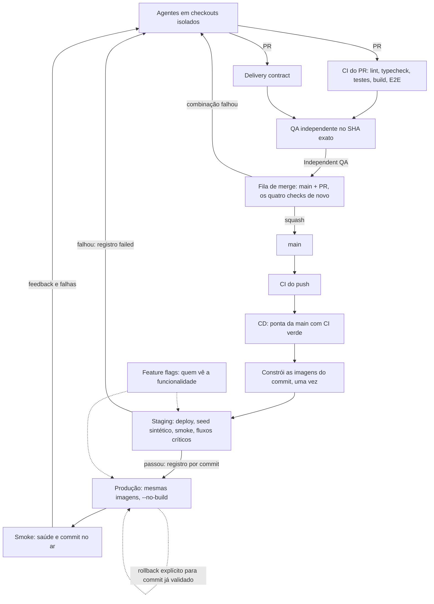

# Integração, staging e produção

Como uma mudança sai de um PR e chega a produção. As regras que decidem estão em código com testes (`scripts/aponta_release.py`, `scripts/aponta_delivery.py`) e nas proteções do repositório; este documento explica e não substitui nenhuma delas.

## Fluxo



Feature flag não é uma etapa: é um controle da funcionalidade, lido em tempo de execução em qualquer ambiente.

## Integração de agentes em paralelo

- Cada PR roda o CI sozinho e em paralelo com os outros (`concurrency` por PR; um push novo cancela só o run anterior do mesmo PR).
- Dois PRs verdes isolados não provam que a combinação funciona. Quem prova é a **fila de merge nativa** (regra `main`, ruleset 26762558): ela monta um commit candidato com a `main` atual mais o PR, roda `Lint, typecheck, unit tests`, `E2E (Playwright, full stack)`, `Delivery contract` e `Independent QA` nesse commit (`merge_group`) e só então integra. Candidato que falha volta para o PR.
- A fila integra um PR por vez (`max_entries_to_merge: 1`, `ALLGREEN`), então cada candidato já contém o que entrou antes.
- Os nomes dos quatro checks são os nomes dos jobs e não mudam com o evento. Nenhum job obrigatório tem `continue-on-error` nem condição que o pule; check ausente, cancelado ou pendente não libera a fila.
- `concurrency` do Actions não é fila: ele descarta pendentes. A ordem e a validação da combinação vêm da fila de merge.
- Atualizar a branch com a `main` não é exigido (`strict` desligado): a fila testa a combinação. A base andar muda o candidato, e o candidato é sempre validado de novo.

## Artefato

`docker-compose.yml` nomeia as imagens pelo commit: `aponta-api:<sha>`, `aponta-web:<sha>`, `aponta-storybook:<sha>`. O deploy constrói uma vez, a partir da árvore exportada do commit (`git archive`), e produção sobe com `--no-build` as imagens que o staging validou. O identificador de cada imagem fica no registro do commit, e a promoção é recusada se a imagem com aquele nome não for mais a mesma.

- A API devolve o commit em `GET /api/version`; o front, em `/version.json`. O smoke compara os dois com o commit esperado.
- O bundle do front embute `VITE_API_URL`. Staging e produção usam o mesmo valor, `/api` (mesma origem, com proxy do nginx), então a imagem é a mesma. Se um ambiente passar a usar outro valor, a imagem deixa de ser promovível e o build precisa ser por ambiente; não mude esse valor sem tratar isso.
- Segredos e configuração ficam fora da imagem, em arquivos de ambiente no servidor: `.env.staging`, `.env.prod` e `.env`.
- Limite: as imagens existem só na VPS. Não há registro externo nem cópia fora do servidor; o identificador é o da imagem local, não um digest de registro.

## Staging

Projeto Compose `aponta-staging`, na mesma VPS: rede, containers, volume do Postgres e volume de uploads próprios (`aponta-staging_*`), portas `127.0.0.1:8190` (web) e `127.0.0.1:8191` (API), credenciais geradas por `aponta_release.py init-staging` e nunca copiadas de produção.

- **Dados**: o seed do projeto (`api:prisma-seed`), sintético. Nenhum dado de produção.
- **Integrações**: `docker-compose.staging.yml` zera SMTP e desliga IMAP; sem transporte o `MailService` aborta todo envio. Não há fila, cobrança nem outro serviço externo no produto hoje.
- **Acesso**: só `127.0.0.1` na VPS. Publicar numa URL exige DNS e um bloco no Caddy com autenticação (ver "Ativação").
- **Compartilhado, não por PR**: um único staging. O ciclo deploy → testes → registro roda sob trava no host (`~/deploy/aponta/locks/staging.lock`) e o workflow roda um ciclo por vez, então nenhum deploy troca a versão enquanto ela é validada. Ambiente por PR não se justifica hoje: a combinação já é validada na fila e a VPS é a mesma de produção.
- **Testes**: página do front, saúde da API, commit da API, commit do front, e os fluxos críticos com o usuário do seed (login, sessão, lista de tickets). A suíte Playwright completa continua rodando no CI; rodá-la contra o staging depende da URL pública.

O resultado vai para `~/deploy/aponta/records/<sha>.json`: commit, identificadores das imagens, cada verificação e o resultado.

## Produção

`aponta_release.py promote` recusa quando: não há registro do commit; o staging não passou; o registro é de outro commit; alguma imagem mudou desde a validação; ou o commit não contém o que está no ar. Um commit mais antigo nunca substitui um mais novo, exceto com `--rollback`.

Depois da troca ele confere saúde e commit em produção e grava o resultado no mesmo registro. Em produção o smoke só lê; não faz login nem cria dado.

O workflow publica sempre a ponta da `main` com CI verde, e não o commit do CI que acabou de terminar. Nenhum run em andamento é cancelado, para não interromper uma migração.

## Recuperação

- **Aplicativo**: `python3 ~/deploy/aponta/releases/<sha-atual>/scripts/aponta_release.py promote --sha <sha-anterior> --rollback`. O alvo precisa ser ancestral do commit no ar, ter registro de staging aprovado e ainda ter as imagens no servidor. Não há build: a troca leva o tempo de recriar os containers.
- **Banco**: rollback de código não desfaz migração. Migrações seguem expandir e contrair: a versão anterior do código precisa funcionar com o schema novo. Só assim o rollback do aplicativo é seguro. Para desfazer dado, o caminho é o backup (`scripts/backup.sh`, dump diário com sete dias de retenção), decidido pelo usuário.
- **Efeitos externos**: e-mail enviado não volta. Funcionalidade com efeito externo novo entra atrás de feature flag desligada.

## Feature flags

Registro em `apps/api/src/feature-flags/feature-flags.ts`: chave, descrição, responsável, valor padrão e data de remoção. O valor por ambiente vem de `FEATURE_<CHAVE>` no arquivo de ambiente; `GET /api/feature-flags` devolve os valores e `useFeatureFlag` os lê no front, desligado por padrão em caso de dúvida. O teste do registro falha no CI quando uma flag passa da data de remoção. O registro começa vazio: nenhuma funcionalidade atual precisa de flag.

## Isolamento

- **CI**: cada job roda numa máquina do GitHub, com o Postgres do próprio job. Nada é compartilhado entre execuções; o relatório do Playwright leva o id e a tentativa da execução no nome.
- **Agentes na VPS**: `scripts/e2e_isolated.sh` sobe um Postgres descartável e portas livres por execução e remove só os containers com o rótulo daquela execução.
- **Ambientes**: nomes de projeto, arquivos de ambiente e portas distintos; `aponta_release.py` monta os comandos e tem teste que impede o staging de usar o arquivo de produção.

## Segurança dos workflows

- Actions fixadas pelo SHA do commit. `appleboy/ssh-action` estava em `@master`.
- `ci.yml` tem `contents: read` e não recebe secret; o checkout não persiste credencial. PR de fork roda sem secret.
- Não há `pull_request_target`. O deploy roda em `workflow_run`, só para CI de `push` na `main` com sucesso, e é o único workflow com os secrets `DEPLOY_*`.
- O deploy não executa código de PR: a árvore vem do commit da `main`, já revisado e validado na fila.

## Ativação e pendências

O que este repositório não consegue fazer sozinho:

1. **Primeiro deploy pelo fluxo novo**: troca os containers de produção para as imagens nomeadas por commit. Acompanhe o run; `.env.staging` é criado na primeira execução se não existir.
2. **URL do staging** (opcional): registro DNS `staging.aponta.cloud` para a VPS e, em `/etc/caddy/Caddyfile`:
   ```
   staging.aponta.cloud {
       tls <e-mail do certificado>
       basic_auth {
           <usuario> <hash gerado por `caddy hash-password`>
       }
       reverse_proxy 127.0.0.1:8190
   }
   ```
   Depois `sudo systemctl reload caddy`. Sem isso o staging funciona e é testado pela VPS, mas ninguém o abre no navegador.
3. **Aprovação humana antes de produção** (opcional): Settings → Environments → `production` → Required reviewers. Sem isso a promoção é automática quando o staging passa.
4. **Secret `TEST_SECRET`**: não é usado por nenhum workflow; pode ser removido.
5. **Custo**: nenhum serviço novo. O staging usa memória e disco da VPS de produção; um servidor separado isolaria falhas de recurso e é decisão de custo do usuário.
6. **Não coberto**: imagens fora do servidor (registro), deploy sem nenhuma indisponibilidade na troca, Playwright contra o staging, e bot de atualização de dependências.
